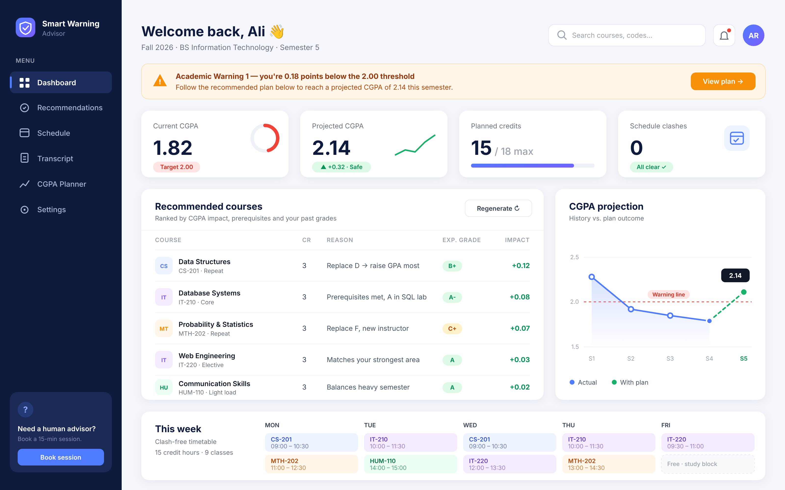
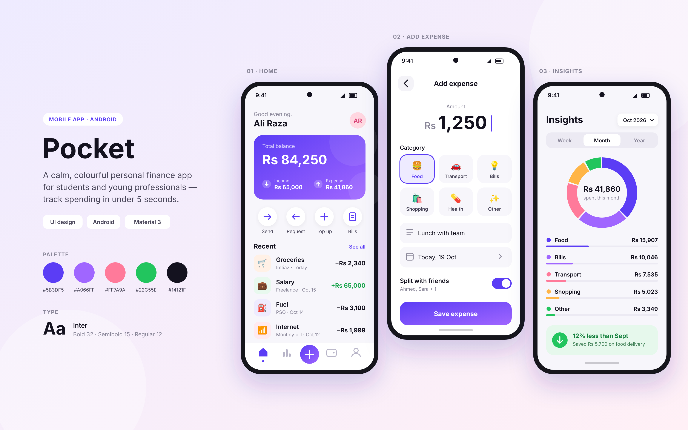
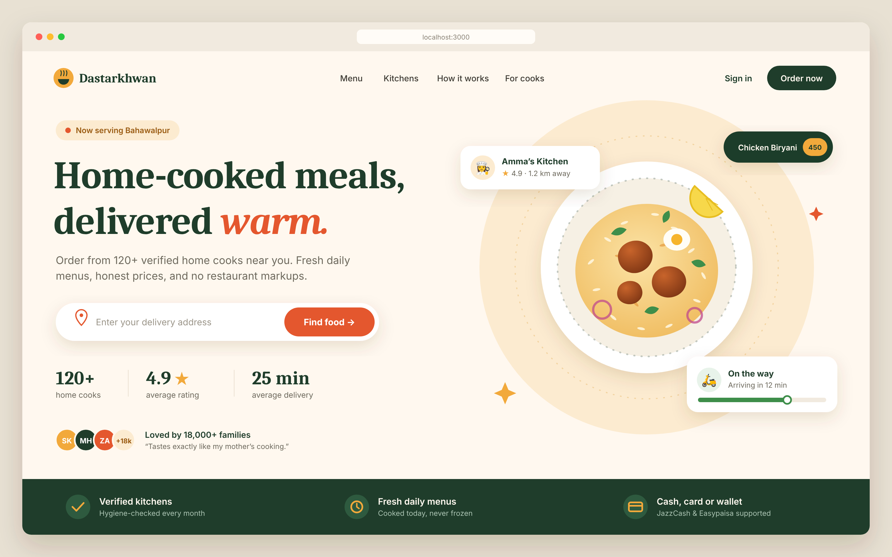

- 👋 Hi, I’m @Ahmad782
- 👀 I’m interested in Programming.
- 🌱 I’m currently learning Android.
- 💞️ I’m looking to collaborate on Android Apps.
- 📫 How to reach me ...

## 🎨 Design Portfolio

> Designed with AI assistance (Claude). Hand-coded as SVG — sources in [`portfolio/src`](portfolio/src).

**Smart Warning Advisor — web dashboard**
An academic advisor that recommends courses, expected grades and a clash-free timetable for students on academic warning, so they get back above a 2.00 CGPA.

**Pocket — Android finance app**
Three core screens (home, add expense, insights) for a personal finance app built on Material 3.

**Dastarkhwan — landing page**
A landing page for a home-cooked food delivery service, in a warm editorial style.

<!---
Ahmad782/Ahmad782 is a ✨ special ✨ repository because its `README.md` (this file) appears on your GitHub profile.
You can click the Preview link to take a look at your changes.
--->
